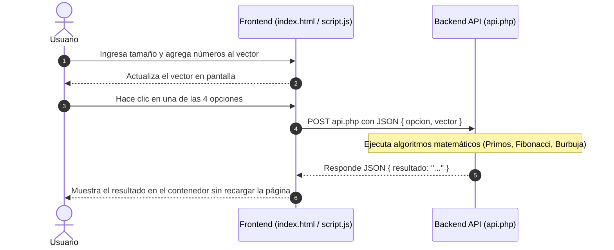

# Ejercicio de Vectores - Aplicación Web con PHP y JavaScript

Aplicación web interactiva basada en una arquitectura **Cliente-Servidor (Frontend + Backend API)** que permite gestionar un vector numérico dinámico y realizar operaciones matemáticas y algorítmicas avanzadas (números primos, serie de Fibonacci, ordenamiento de burbuja y estadísticas).

---

## 📁 Estructura del Proyecto

El proyecto está organizado en la carpeta `proyecto web/` de la siguiente forma:

```text
proyecto web/
├── index.html     # Interfaz de usuario y estructura visual (HTML5)
├── style.css      # Hoja de estilos y diseño responsivo (CSS3)
├── script.js      # Lógica del cliente, manejo del DOM y peticiones asíncronas (JavaScript)
├── api.php        # Servidor backend y procesamiento de algoritmos (PHP)
└── README.md      # Documentación completa del proyecto
```

---

## 🏛️ Arquitectura del Sistema

El sistema implementa una separación clara de responsabilidades:



1. **Frontend (Cliente)**:
   * **[index.html](file:///home/motoaki/Documents/ing-software-1/proyecto%20web/index.html)**: Define la estructura, formularios de entrada para tamaño y números, y botones de opciones.
   * **[style.css](file:///home/motoaki/Documents/ing-software-1/proyecto%20web/style.css)**: Estilos limpios y centrados, con diferenciación de campos y área de resultados.
   * **[script.js](file:///home/motoaki/Documents/ing-software-1/proyecto%20web/script.js)**: Controla el llenado del vector, validaciones en el navegador, reinicio y envía peticiones mediante `fetch()` al backend en PHP.

2. **Backend (Servidor)**:
   * **[api.php](file:///home/motoaki/Documents/ing-software-1/proyecto%20web/api.php)**: Endpoint REST que recibe las peticiones `POST` en formato JSON, ejecuta la lógica de negocio y los cálculos computacionales, y devuelve la respuesta en JSON.

---

## ⚙️ Descripción Detallada de los Archivos

### 1. `index.html`
* Proporciona la interfaz interactiva.
* Controles principales:
  * **Definir tamaño**: Establece la cantidad máxima de elementos que aceptará el vector.
  * **Ingresar número / Agregar**: Inserta números uno a uno hasta alcanzar el límite fijado.
  * **Reiniciar**: Limpia el vector y los campos en pantalla.
  * **Botones de opciones (1 al 4)**: Disparan las consultas hacia el backend.
  * **Área de resultado (`#resultado`)**: Contenedor dinámico donde se inserta la respuesta devuelta por PHP.

### 2. `script.js`
* Administra las variables globales del cliente:
  * `vector`: Arreglo en memoria con los números agregados.
  * `tamano`: Capacidad definida para el vector.
* **Funciones de interfaz**:
  * `definirTamano()`: Valida y asigna el tamaño límite.
  * `agregarNumero()`: Añade el valor ingresado al arreglo mientras haya capacidad disponible.
  * `reiniciar()`: Resetea todos los estados y campos de texto.
* **Comunicación con el servidor**:
  * `procesarOpcion(opcion)`: Función asíncrona (`async/await`) que utiliza la API `fetch` para enviar `{ opcion, vector }` a `api.php`. Gestiona además estados de carga ("Calculando en el servidor PHP...") y captura de errores si el servidor no está encendido.
  * `opcion1()`, `opcion2()`, `opcion3()`, `opcion4()`: Disparadores que llaman a `procesarOpcion(n)`.

### 3. `api.php`
* Configura la cabecera HTTP: `header('Content-Type: application/json; charset=utf-8')`.
* Lee el cuerpo de la petición mediante `file_get_contents('php://input')` y decodifica el JSON con `json_decode()`.
* **Funciones matemáticas auxiliares**:
  * `esPrimo($n)`: Comprueba si un número $n \ge 2$ es primo dividiendo únicamente hasta $\sqrt{n}$ para máxima eficiencia.
  * `esFibonacci($n)`: Determina si un número pertenece a la serie de Fibonacci ($0, 1, 1, 2, 3, 5, 8, \dots$) generando la serie iterativamente hasta alcanzar o superar $n$.
* **Estructura de control (`switch ($opcion)`)**: Procesa cada una de las 4 opciones solicitadas.

---

## 🧠 Lógica de las Opciones

### Opción 1: Contar primos en posiciones Fibonacci múltiplos de 3
* **Objetivo**: Recorrer el vector e identificar aquellos elementos que cumplan tres condiciones simultáneas:
  1. El valor dentro del vector sea un número primo: `esPrimo($vector[$i])`.
  2. La **posición (índice $i$)** pertenezca a la serie de Fibonacci: `esFibonacci($i)`.
  3. La **posición (índice $i$)** sea múltiplo de 3: `$i % 3 === 0`.
* **Resultado**: Cantidad total de elementos que cumplen la condición.

### Opción 2: Contar primos en posiciones primas y múltiplos de 3, 4, 5 o 7
* **Objetivo**: Contar los elementos del vector que cumplan:
  1. El valor sea primo: `esPrimo($vector[$i])`.
  2. La **posición (índice $i$)** sea prima: `esPrimo($i)`.
  3. La **posición (índice $i$)** sea múltiplo de 3, 4, 5 o 7: `($i % 3 == 0 || $i % 4 == 0 || $i % 5 == 0 || $i % 7 == 0)`.
* **Resultado**: Cantidad total de números encontrados.

### Opción 3: Ordenar con burbuja primos Fibonacci (mayor a menor)
* **Objetivo**:
  1. Filtrar los valores del vector que sean a la vez números primos y números pertenecientes a la sucesión de Fibonacci: `esPrimo($val) && esFibonacci($val)`.
  2. Aplicar el algoritmo tradicional de **ordenamiento de la burbuja (Bubble Sort)** en orden descendente (de mayor a menor) intercambiando elementos adyacentes cuando `lista[j] < lista[j + 1]`.
* **Resultado**: El arreglo filtrado y ordenado.

### Opción 4: Promedio, mayores al promedio y menor con posición
* **Objetivo**:
  1. Calcular la suma total y el promedio aritmético del vector: $\text{promedio} = \frac{\sum \text{elementos}}{N}$.
  2. Recorrer el vector para obtener:
     * Lista de todos los números que superan dicho promedio (`$vector[$i] > $promedio`).
     * El número de menor valor junto con su posición (índice).
* **Resultado**: Promedio formateado a 2 decimales, lista de números mayores al promedio con sus respectivas posiciones y el número menor con su posición.

---

## 🚀 Requisitos e Instalación

### Requisitos previos
* **PHP 8.x** instalado en el sistema.
* Un navegador web moderno (Firefox, Chrome, Brave, Edge, etc.).

### Instalación de PHP (en Arch Linux / CachyOS)
Si aún no está instalado:
```bash
sudo pacman -Sy php
```

Para verificar la instalación:
```bash
php -v
```

---

## ▶️ Cómo Ejecutar el Proyecto

1. Abre una terminal y dirígete a la carpeta del proyecto:
   ```bash
   cd ~/Documents/ing-software-1/proyecto\ web
   ```

2. Inicia el servidor de desarrollo integrado de PHP:
   ```bash
   php -S localhost:8000
   ```

3. Abre tu navegador web e ingresa a:
   ```text
   http://localhost:8000
   ```

4. **Uso de la aplicación**:
   * Escribe el tamaño deseado (ej. `6`) y haz clic en **Definir tamaño**.
   * Ingresa los números uno por uno y haz clic en **Agregar**.
   * Presiona cualquiera de los 4 botones de opciones para ver el resultado procesado en PHP.
